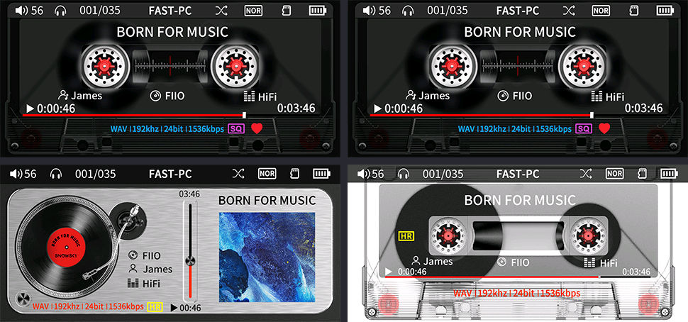
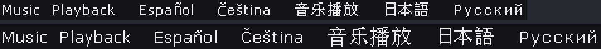
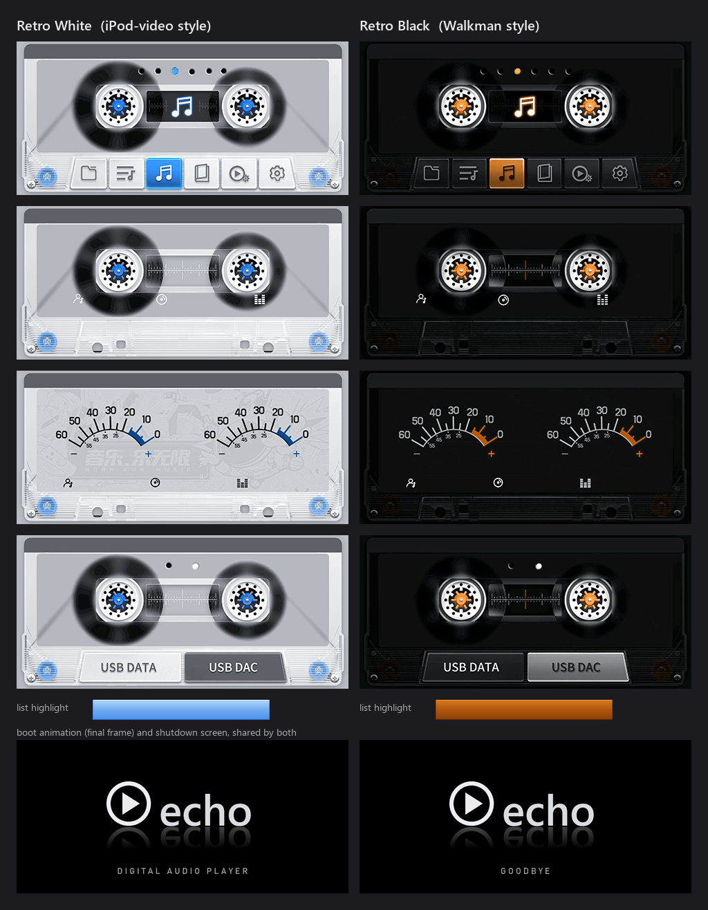

# SNOWSKY Echo Mini firmware V1.9.0 teardown

Reverse engineering of `ECHOV190.IMG`, the firmware for FiiO's SNOWSKY Echo Mini cassette-style player.
Everything here was worked out from the image itself: header parsing, resource decoding and Thumb-2 disassembly.

This repo contains no firmware. Download the official `ECHOV190.IMG` from FiiO/SNOWSKY and build the mod from it (see below).



## What's inside

| | |
|---|---|
| SoC / SDK | Rockchip **RKnano** ("RKnano SDK 1.0"): bare-metal C with code overlays, no Linux and no RTOS |
| CPUs | Two Cortex-M cores. The system/UI core runs from SRAM at `0x0300_0000`. The audio core runs the codecs at `0x0100_0000` (code) and `0x0102_0000` (data), and asks the system core for file I/O (`HifiFileRead: timeout!!` etc.) |
| Display | 480×222, RGB565 |
| DAC | Two chips on I²C (`dac60_Left` / `dac66_Right`). The five filter modes (fast/slow × minimum/linear phase, plus NOS) match Cirrus CS43131 |
| Codecs | MP3, WMA, AAC/M4A, WAV, OGG, FLAC, ALAC, APE, DFF and DSF, one overlay each on the audio core |
| Build date | 2026-08-24 (BCD in the header) |
| UI text | 21 languages × 453 menu/message strings |
| Graphics | 819 bitmaps covering two themes. Plain names are *Elegant White* and `B…` names are *Midnight Black* |

There are also leftovers from the generic RKnano SDK: menu strings for an FM radio, a voice recorder, a dictionary, a Chinese lunar calendar, video and photo viewers.

### Image layout

| Offset | Size | Content |
|---|---|---|
| `0x000000` | 512 B | Header. BCD date, magic `0x76543210`, `Rockchip`, `RKnano SDK 1.0`, the blob table below, body size at `0x1F4`, tag `RKnanoFW` at `0x1F8` |
| `0x000200` | 1.5 MB | **system**: segment table (91 × {code load/exec/len, data load/exec/len, bss}), then all code |
| `0x177704` | 2.0 MB | **font12**: 65 536 glyphs × 32 B (12 rows × 16-bit big-endian bitmap, then a width byte `0x80\|w`) |
| `0x37930a` | 2.1 MB | **font16**: 65 536 glyphs × 33 B (16 rows × 16-bit, then a width byte) |
| `0x58af10` | 1.8 MB | **charsets**: 14 × 128 KB legacy code-page→Unicode tables (for ID3v1 and FAT names), plus a pinyin-initial table for the 20 902 CJK ideographs (media-library sorting) |
| `0x75525a` | 2.3 MB | **menu**: `u16 count`, `u32 offsets[21]`, then per language 453 × 258-byte records. Each record is 29 u16 tree fields (id, parent, index, first child, prev, next, value, child count, …) followed by up to 99 UTF-16 characters |
| `0x9ac602` | 28 MB | **images**: `ROCK26IMAGERES`, count, then 16-byte entries {w, h, x, y, length, offset}. Pixels are **big-endian RGB565**. After the last bitmap the packer left 108-byte records holding each original BMP filename |
| `0x25c4000` | | Copy of the 512-byte header, zero padding to a 1 MiB boundary, then **RKCRC32** (poly `0x04C10DB7`, init 0) over everything before it |



### How the player installs firmware (from disassembly)

1. **Scan** (segment 1, `0x0307DEFE`): at boot the player opens `\ECHOECHO.IMG`, then tries `\ECHOV100.IMG` through `\ECHOV498.IMG`. It does **not** compare the number with the installed version, so downgrades are allowed.
2. **Validate and write** (segment 8, `0x0307E9F0`): it checks for `RKnanoFW` at `0x1F8` and that the header copy at the end matches the first 512 bytes. It then writes the image to the backup slot in 8 KB chunks, reading each one back to verify, with the header last. Finally it copies the image over the primary slot and deletes the `.IMG` file.
3. **Boot check** (segment 1, `0x0307EE14`): the `fw1 Sign error!` message is just a `memcmp` against `RKnanoFW`. The check then compares the two header copies and boots the newer of the two slots by header date.

There is **no cryptographic signature**, and the device never reads the trailing CRC (Rockchip's PC tools do). The writer reads the file up to the rounded 1 MiB size, so modified images must keep their exact size. `echofw.py` always does.

## Toolkit

Requires Python 3 and Pillow (`pip install pillow`).

```bash
python echofw.py info "ECHOV190.IMG"
```

```bash
python echofw.py unpack "ECHOV190.IMG" v190
```

```bash
python echofw.py pack v190 ECHOECHO.IMG
```

- `unpack` creates the following folders:
  - `images/NNN_NAME.png`: all 819 bitmaps, named after their original BMPs.
  - `strings/NN_lang.tsv`: menu text for each language.
  - `code/`: every segment as its own `.bin`, plus `segments.tsv` with the execution addresses for Ghidra or IDA (ARM Cortex-M, Thumb, little-endian).
  - `raw/`: the fonts, charset tables and menu blob.
- `pack` writes back only what you changed, in place. PNGs must keep their dimensions and strings are limited to 99 characters. It then rewrites the tail header and the CRC. An unedited `pack` reproduces the official file byte-for-byte.
- `--text-patch file.tsv` (`lang⇥index⇥text`, with `*` meaning every language) and `--images dir` apply overrides without touching the unpacked folder.

## The mod

`mods/` builds `ECHOECHO.IMG`: stock V1.9.0 with fixes to text and one graphic. **No code was changed.**

- **Dark-theme filter badge read "NON-OC".** It now says "NON-OS", matching the light theme. The "S" glyph came from the dark theme's own "FAST-PC" badge ([before/after](docs/non-os-fix.png)).
- **Language picker names.** "Spanish" is now "Español", "Hollands" is now "Nederlands", and "Číština" is now "Čeština" in all 21 languages. The Czech translation already had the correct spelling.
- **English menu fixes**, checked against the Chinese source text:

  | Before | After |
  |---|---|
  | RECORE FILE | Recordings |
  | Breakpoint player | Resume Playback |
  | Magnetic tape style | Cassette Style |
  | VU watch style | VU Meter Style |
  | Cadence style | Rhythm Style |
  | Folder Jumping Song | Cross-Folder Skip |
  | Filter | Digital Filter |
  | Button Switching | Button Mode |
  | Volume button swap | Swap Volume Buttons |
  | Lyrics switch | Lyrics |
  | 1 Minutes | 1 Minute |
  | Midnight black | Midnight Black |
  | UAC charging mode | UAC Charging Mode |
  | Text Settings (with trailing spaces) | Text Settings |
  | Back paper selection | Background |

  The full list is in `mods/text-fixes.tsv`.

To build it, unpack the official image, then pack it with the fixes:

```bash
python echofw.py unpack "ECHOV190.IMG" v190
```

```bash
python echofw.py pack v190 ECHOECHO.IMG --text-patch mods/text-fixes.tsv --images mods/images
```

`info` on the result should report `RKCRC32 … OK`. The build is deterministic, so the CRC should be `0x2a747924`.

**Installing (at your own risk; not yet tested on a device):**

1. Charge the player.
2. Take out the TF card.
3. Copy `ECHOECHO.IMG` to the root of the player's internal storage.
4. Eject the player and restart it.

The player deletes the file after flashing. To go back to stock, do the same with the official `ECHOV190.IMG`.

The mod passes the same checks as the official file and changes only text slots and pixels, with every offset and size unchanged. The update routine lives in the main firmware, though. If a firmware ever failed to boot far enough to scan for `.IMG` files, recovery would need Rockchip's USB recovery tools, which I haven't tried with this player.

## Retro theme

`themes/retro/` restyles both interface styles after mid-2000s MP3 players. It also includes the fixes above.



- **Retro White (iPod video, 2005):** brighter silver-white, with blue in place of red. List highlights become a glossy blue gradient bar, and the selected menu tile and page dot turn blue.
- **Retro Black (Sony Walkman, 2007):** deeper black, with orange in place of red. List highlights become an orange gradient bar, and the selected tile and page dot turn orange.
- **Boot and shutdown:** a new animation (a ring draws in, a play mark appears, then the `echo` wordmark wipes in with a glossy reflection) and a matching "goodbye" screen. Both themes share these.
- **Menu names:** Settings → Interface Style shows "Retro White" and "Retro Black".

To build it:

```bash
python themes/retro/make_retro.py v190 themes/retro/build
```

```bash
python echofw.py pack v190 ECHOECHO.IMG --text-patch mods/text-fixes.tsv --text-patch themes/retro/text.tsv --images mods/images --images themes/retro/build
```

The result should have RKCRC32 `0x2f55370c`. The generator needs numpy and Pillow, and the Windows fonts Segoe UI Semibold and Bahnschrift.

**What it relies on (found in the code):**
- Images 093 and up are themed. The firmware adds 363 to the image number when the Black theme is on (setting byte `+0x349`), so 093–455 are White and 456–818 are Black. Images 000–092 are shared.
- List text is black on the White theme and white on the Black theme (`0x3065A7E`). The new highlight bars keep about the stock bars' brightness, so the text stays readable.
- Pure red `(255,0,0)` is a transparency key wherever it has hard edges: dialog-box corners, tape-strip overlays, and the USB-DAC frames' cut-out for the page dots. Those pixels are never changed. Anti-aliased pure red (the progress knob, reel hubs) is a visible colour and gets recoloured.
- Boot frames are drawn at the top-left and cropped on the right and bottom. The generator simulates playback and fails if any frame would leave pixels behind.

## Ideas for further work

- **More themes:** `themes/retro/make_retro.py` is a starting point. `000`–`009` are full-screen `TEST` images (sample player screens, a logo and RGB bars) whose use I haven't confirmed.
- **Better fonts:** the 12/16 px fonts are 1-bit with no anti-aliasing. A pixel font could be rasterised into the same glyph slots.
- **Code patches** (volume curve, the 3-second "previous track" threshold, button modes) are possible. The overlays are small and load at fixed addresses. They would need more reverse engineering and a way to recover a bricked unit before trying.
